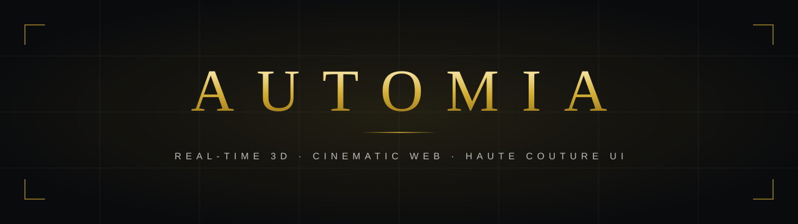

 

**A creative development studio for brands that want to be experienced, not scrolled.** 
Real-time 3D on the web, cinematic interaction and interfaces cut to measure.

 

---

## What we make

<table>
<tr>
<td width="33%" valign="top">

### Real-time 3D
Venues, products and places rebuilt in WebGL, explorable in the browser on any phone. No app, no plugin.

</td>
<td width="33%" valign="top">

### Cinematic web
Camera moves, light and sound directed like a film: openings that set the tone, tours that tell the story.

</td>
<td width="33%" valign="top">

### Haute couture UI
Interfaces drawn for one brand only: glass, gold and type set with care, from the first loading screen to the booking.

</td>
</tr>
</table>

---

## Selected work

<table>
<tr>
<td width="100%" valign="top">

### [Banzai, Reggio Calabria](https://github.com/Automia-labs/showcase-banzai-3d)
Restaurant &middot; interactive 3D digital twin &middot; 2026

A sushi and burger restaurant on the Lungomare, rebuilt as an explorable 3D scene. A cinematic opening, a dark architectural model of the neighbourhood, a glass conservatory, the real menu on the table, a 3D plate builder and booking on WhatsApp, in seven languages.

   

</td>
</tr>
</table>

---

## How we work

- **One brand, one design.** No templates. Every scene, material and interface is made for the client.
- **Fast on real phones.** Adaptive resolution and careful memory use, so the experience stays smooth where most guests see it.
- **Built to convert.** Every experience ends in an action that matters to the business: a booking, an order, a visit.
- **Delivered complete.** Design, development, multilingual copy and deployment, handed over ready to run.

---

## Toolkit

---

Automia &middot; creative development studio &middot; Italia

